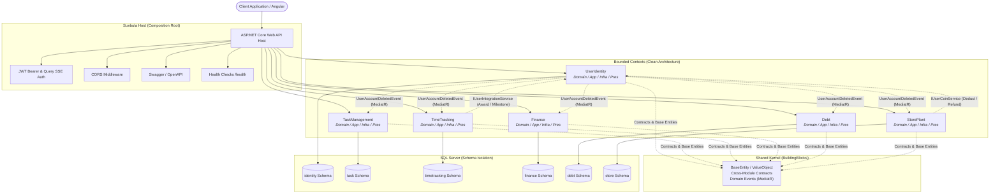
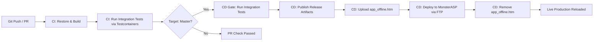

<div align="center">

# 🌱 Sunbula (سُنبلة) — Modular Monolith Backend

[](https://dotnet.microsoft.com/)
[](https://learn.microsoft.com/en-us/dotnet/csharp/)
[](https://www.microsoft.com/sql-server)
[](https://dotnet.testcontainers.org/)
[](https://www.docker.com/)
[](LICENSE)

**A Modular Monolith backend for personal productivity, financial intelligence, and gamification built with .NET 10, exploring Domain-Driven Design (DDD), Clean Architecture, and isolated persistence boundaries.**

[Live Production Health Probe](https://sunbula.runasp.net/health) • [Frontend Client](https://github.com/hassans22hh-ship-it/SunbulaFrontEnd)

</div>

---

## 📑 Table of Contents

- [Project Overview](#-project-overview)
- [Architecture & Design Principles](#-architecture--design-principles)
- [Bounded Contexts (Modules)](#-bounded-contexts-modules)
- [Cross-Module Consistency & Event Choreography](#-cross-module-consistency--event-choreography)
- [Tech Stack](#-tech-stack)
- [Getting Started](#-getting-started)
  - [Option A: Docker & Docker Compose (Recommended)](#option-a-docker--docker-compose-recommended)
  - [Option B: Local .NET CLI](#option-b-local-net-cli)
- [Configuration & Startup Hygiene](#-configuration--startup-hygiene)
- [CI/CD & Deployment Strategy](#-cicd--deployment-strategy)
- [Database Migrations & Seeding](#-database-migrations--seeding)
- [Testing & Quality Assurance](#-testing--quality-assurance)
- [Architectural Trade-offs & Known Limitations](#-architectural-trade-offs--known-limitations)
- [Git Flow & Branching Strategy](#-git-flow--branching-strategy)
- [License](#-license)

---

## 📌 Project Overview

**Sunbula** is a personal life-management backend designed to unify fragmented daily workflows into a coherent domain model:

- **Productivity & Time Tracking:** Pomodoro timers, focus sessions, work categorization, and task prioritization.
- **Financial Intelligence:** Income and expense ledgers, multi-wallet cashflow tracking, categorized summaries, and creditor/debtor installment tracking.
- **Gamification Economy:** Earning in-game coins by logging focused work sessions and maintaining daily streaks, with an in-app nursery store to unlock, cultivate, and grow virtual plants.

---

## 🏛 Architecture & Design Principles

Sunbula is structured as a **Modular Monolith** — an architectural pattern combining single-unit deployment simplicity with independent domain modules, clean boundaries, and isolated persistence.



### Core Tenets:
1. **Clean Architecture per Module:** Every module maintains autonomous `Domain`, `Application`, `Infrastructure`, and `Presentation` projects.
2. **Dedicated DbContexts & Schema Isolation:** Zero cross-context database foreign keys or LINQ joins. Each module owns its EF Core `DbContext` and schema namespace (`identity`, `store`, `finance`, etc.).
3. **Explicit Cross-Module Contracts:** Cross-module communication is mediated strictly via abstractions in `SharedKernel` or asynchronous domain events. Direct project dependencies between module domain/infrastructure layers are strictly prohibited.

---

## 🧩 Bounded Contexts (Modules)

```
Modules/{ModuleName}/
├── Domain/            # Aggregate Roots, Entities, Value Objects, Domain Events
├── Application/       # Service Abstractions, DTOs, Mappings, Event Handlers
├── Infrastructure/    # EF Core DbContext, Repositories, Migrations, External Integrations
└── Presentation/      # API Controllers (loaded dynamically into the Host)
```

| Module | Core Responsibility | Persistence Schema | Core Entities |
| :--- | :--- | :--- | :--- |
| **`UserIdentity`** | User credentials, password hashing, JWT generation, coin ledger | `identity` | `User`, `UserRefreshToken`, `UserSettings` |
| **`TaskManagement`** | Task hierarchies, deadlines, priority scoring, tags | `task` | `Task`, `Category`, `TaskColor` |
| **`TimeTracking`** | Focus session intervals, Pomodoro allocations, streak tracking | `timetracking` | `TimeSession`, `TimeSpanAllocation` |
| **`Finance`** | Income/expense cashflows, wallet management | `finance` | `Transaction`, `FinancialCategory`, `Wallet` |
| **`Debt`** | Debts, creditor/debtor directory, payment schedules | `debt` | `Debt`, `Installment` |
| **`StorePlant`** | Nursery catalog, plant purchase, growth and watering stages | `store` | `Plant`, `UserPlant` |

---

## 📡 Cross-Module Consistency & Event Choreography

### Plant Purchase Flow (Synchronous Compensating Action Pattern)

Because `UserIdentity` (coin balance) and `StorePlant` (plant ownership) reside in separate `DbContext` instances, cross-module consistency is coordinated using a **synchronous internal contract (`IUserCoinService`) with a best-effort compensating refund**:


### Active Cross-Module Contracts & Events

| Mechanism | Source | Target | Delivery / Role |
| :--- | :--- | :--- | :--- |
| `UserAccountDeletedEvent` | **UserIdentity** | `Debt`, `Finance`, `StorePlant`, `TaskManagement`, `TimeTracking` | In-Process MediatR (`INotification`): Cascades user account deletion across all bounded contexts |
| `CoinBalanceChangedEvent` | **UserIdentity** | Connected Clients | In-Process MediatR (`INotification`): Dispatches balance updates to `CoinStreamManager` for SSE live streaming |
| `IUserCoinService` | **StorePlant** | **UserIdentity** | Synchronous internal service call: Deducts plant purchase/watering coins with best-effort rollback refund on persistence failure |
| `IUserIntegrationService` | **TimeTracking** | **UserIdentity** | Synchronous internal service call: Awards focus session coins (`AddCoinsAsync`) and daily streak bonuses (`AwardStreakMilestoneAsync`) |

---

## 💻 Tech Stack

| Component | Technology | Version / Details |
| :--- | :--- | :--- |
| **Runtime & Language** | .NET | `10.0` (C# 14 compiler) |
| **Web Framework** | ASP.NET Core Web API | Kestrel Server, Minimal APIs + Dynamic Controllers |
| **ORM & Data Access** | Entity Framework Core | `10.0` (Code-First with Per-Module Migrations) |
| **Database Engine** | Microsoft SQL Server | `2022-latest` (Docker & Windows Server) |
| **Integration Testing** | Testcontainers.MsSql | `4.3.0` (Containerized SQL Server test fixtures) |
| **Test Runner & Assertions**| xUnit, FluentAssertions | `xUnit 2.9.3`, `FluentAssertions 7.2.0` (Apache 2.0) |
| **Authentication** | JWT (JSON Web Tokens) | HMAC-SHA256, Refresh Token Rotation |
| **In-Process Messaging** | MediatR | `12.4.1` (`INotification` / `INotificationHandler`) |
| **Object Mapping** | AutoMapper | Assembly-scanned module profiles |
| **Containerization** | Docker & Docker Compose | Multi-stage production build |

---

## 🚀 Getting Started

### Option A: Docker & Docker Compose (Recommended)

Run the complete stack (API + SQL Server 2022) without installing local SDKs or database servers:

1. **Clone the repository:**
   ```bash
   git clone https://github.com/hassans22hh-ship-it/SunbulaGraduationProject.git
   cd SunbulaGraduationProject
   ```

2. **Configure environment variables:**
   ```bash
   cp .env.example .env
   ```

3. **Start the containers:**
   ```bash
   docker compose up -d --build
   ```

4. **Verify running containers:**
   ```bash
   docker compose ps
   ```
   - **API Host:** `http://localhost:5000`
   - **Health Check:** `http://localhost:5000/health`
   - **SQL Server:** `localhost:1433`

---

### Option B: Local .NET CLI

1. **Prerequisites:**
   - [.NET 10.0 SDK](https://dotnet.microsoft.com/download/dotnet/10.0)
   - Microsoft SQL Server 2022 (local or containerized)

2. **Setup configuration:**
   ```bash
   cp Sunbula/appsettings.Example.json Sunbula/appsettings.json
   ```

3. **Build the solution:**
   ```bash
   dotnet build SunbulaGraduationProject.slnx -c Release
   ```

4. **Run the API:**
   ```bash
   dotnet run --project Sunbula/Sunbula.csproj
   ```
   - Health Probe: `http://localhost:5142/health`

---

## 🔐 Configuration & Startup Hygiene

Configuration follows standard .NET hierarchical configuration providers (`appsettings.json` -> `appsettings.{Environment}.json` -> Environment Variables).

### Startup Hygiene & Security Gates:
- **Default Admin Seeding:** In `DatabaseInitializer.cs`, default admin seeding (`admin@sunbula.com` / `AdminPassword123!`) is strictly gated behind `env.IsDevelopment()`. Hardcoded credentials will never be seeded into Staging or Production databases.
- **Automated Migrations Flag:** Startup migrations are gated via configuration flag `"Database:AutoMigrate"`. Configured as `false` in `appsettings.Production.json` to prevent race conditions and schema locks during multi-instance deployment.

### Key Environment Mappings:

| Key | Environment Variable | Purpose |
| :--- | :--- | :--- |
| `Database:AutoMigrate` | `Database__AutoMigrate` | Enables/disables automatic startup migrations |
| `ConnectionStrings:SunbulaDb` | `ConnectionStrings__SunbulaDb` | SQL Server connection string |
| `Jwt:SecretKey` | `Jwt__SecretKey` | HMAC-SHA256 256-bit signing key |
| `Jwt:Issuer` | `Jwt__Issuer` | Valid token issuer(s) |
| `EmailSettings:Email` | `EmailSettings__Email` | SMTP sender address |
| `EmailSettings:Password` | `EmailSettings__Password` | SMTP application password |

---

## 🔄 CI/CD & Deployment Strategy

Sunbula utilizes a pragmatic CI/CD pipeline built on **GitHub Actions** tailored for cost efficiency and automated releases:



### Deployment Details:
- **Hosting Provider:** [MonsterASP.net](https://www.monsterasp.net/) (Windows / IIS Shared Hosting).
- **Deployment Mechanism:** Secure FTP synchronization via GitHub Actions (`.github/workflows/cd.yml`).
- **Integration Test Gate:** MonsterASP FTP deployment requires the `Run Integration Test Gate` job to pass first.
- **File Locking Strategy:** An `app_offline.htm` file is uploaded to the application root before file transfer to instruct ASP.NET Core Module (ANCM) in IIS to release file locks on assemblies (`.dll`), then removed immediately after synchronization to trigger a clean application restart.

---

## 🗄 Database Migrations & Seeding

Each module manages its own migrations independently through separate assembly migrations:

```bash
# User Identity
dotnet ef database update --context UserIdentityDbContext --project Sunbula

# Task Management
dotnet ef database update --context TaskManagementDbContext --project Sunbula

# Time Tracking
dotnet ef database update --context TimeTrackingDbContext --project Sunbula

# Finance
dotnet ef database update --context FinanceDbContext --project Sunbula

# Debt
dotnet ef database update --context DebtDbContext --project Sunbula

# Store Plant
dotnet ef database update --context StorePlantDbContext --project Sunbula
```

---

## 🧪 Testing & Quality Assurance

Integration tests run against a real Microsoft SQL Server 2022 container via **`Testcontainers.MsSql`**, ensuring test fidelity across SQL transactions, foreign keys, schema isolation, and raw SQL operations.

```bash
dotnet test Sunbula.IntegrationTests/Sunbula.IntegrationTests.csproj -c Release
```
*(Note for Linux users running custom or rootless Docker socket configurations: prefix with `DOCKER_HOST="unix:///var/run/docker.sock"` if the Docker daemon socket is not discovered automatically).*

### Shared Fixture Architecture:
- `CustomWebApplicationFactory` implements `IAsyncLifetime` to manage a single shared SQL Server container across the test run via `[CollectionDefinition("IntegrationTests")]`.
- Replaces external outbound network dependencies (e.g. SMTP email sending) with `TestNoOpEmailService` to guarantee reliable offline test execution.
- Tests cover full authentication, registration, email confirmation, task priority filtering, debtor installment records, focus sessions, and plant purchases with coin deductions.

---

## ⚖️ Architectural Trade-offs & Known Limitations

1. **Dual DbContexts & Best-Effort Compensating Actions:**
   - *Current State:* `StorePlant` and `UserIdentity` operate on separate `DbContext` instances with dedicated schema namespaces (`identity`, `store`, etc.). Cross-module coin transactions (such as plant purchase and watering) rely on a synchronous check-and-deduct contract followed by a best-effort compensating refund in the `catch` block on persistence failure.
   - *Failure Mode:* Because these operations are not wrapped in a single shared database transaction or a durable Outbox/Saga, if the application host crashes between deduction and persistence, or if a database failure occurs during both the insert and the refund, coin balances can become inconsistent. Achieving true atomicity across modules would require either coordinating within a shared database transaction (since all schemas live on the same database) or implementing an asynchronous transactional outbox with durable idempotency.
2. **In-Process MediatR vs. Distributed Message Broker:**
   - *Current State:* Domain events (such as `UserAccountDeletedEvent` and `CoinBalanceChangedEvent`) are dispatched in-process using `MediatR`.
   - *Trade-off:* While this avoids the infrastructure complexity of external message brokers, events are volatile and limited to a single application instance. Multi-instance horizontal scaling would require migrating to an external message broker (such as RabbitMQ, Azure Service Bus, or MassTransit).
3. **Logical Schema Isolation on a Shared Database Catalog:**
   - *Current State:* Each bounded context defines an isolated database schema (`identity`, `store`, `timetracking`, `finance`, `debt`, `task`). However, all schemas currently share a single physical SQL Server database instance to keep hosting costs at zero for this project.
   - *Trade-off:* The modules are logically decoupled but share connection pool limits and database hardware resources.
4. **FTP Deployment Maintenance Window:**
   - *Current State:* Deployments to MonsterASP shared Windows hosting occur via FTP. To prevent file-lock errors on executing `.dll` assemblies, the deployment pipeline uploads `app_offline.htm` during file synchronization.
   - *Trade-off:* The application experiences a brief (30-60 second) maintenance window during release deployments, rather than zero-downtime blue/green or rolling deployments.
5. **Startup Migrations in Production Environments:**
   - *Current State:* Migrations can be run on startup via `DatabaseInitializer.cs`.
   - *Trade-off:* While convenient for local development, automatic migration execution on startup is dangerous in multi-instance production environments. The `"Database:AutoMigrate"` flag is configured to `false` in production, and migrations applied via CI/CD migration bundles.

---

## 🌿 Git Flow & Branching Strategy

- **`master`:** Production releases deployed to MonsterASP.
- **`develop`:** Integration branch for feature development.
- **`feature/{module}-{description}`:** Isolated feature branches.
- **`hotfix/{issue}`:** Critical patches branched from and merged into `master`.

---

## 📄 License

This project is licensed under the terms of the [MIT License](LICENSE).
