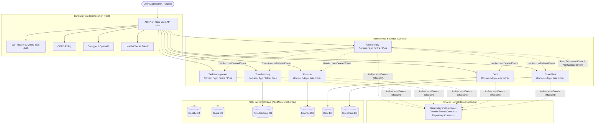
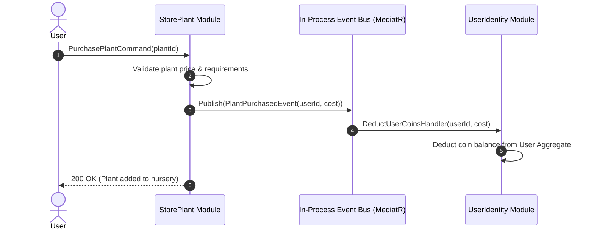
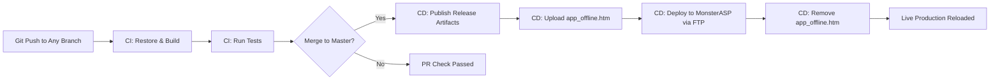

<div align="center">

# 🌱 Sunbula (سُنبلة) — Modular Monolith Backend

[](https://dotnet.microsoft.com/)
[](https://learn.microsoft.com/en-us/dotnet/csharp/)
[](https://www.microsoft.com/sql-server)
[](https://www.docker.com/)
[](https://github.com/features/actions)
[](LICENSE)

**An enterprise-ready productivity & personal finance system built with .NET 10, Domain-Driven Design (DDD), Clean Architecture, and a resilient Modular Monolith pattern.**

[Live Production API](https://sunbula.runasp.net/health) • [Frontend Client](https://github.com/hassans22hh-ship-it/SunbulaFrontEnd) • [Swagger Docs](http://localhost:5142/swagger)

</div>

---

## 📑 Table of Contents

- [Executive Summary](#-executive-summary)
- [Architecture & Design Principles](#-architecture--design-principles)
- [Bounded Contexts (Modules)](#-bounded-contexts-modules)
- [Domain Event Choreography](#-domain-event-choreography)
- [Tech Stack](#-tech-stack)
- [Getting Started](#-getting-started)
  - [Option A: Docker & Docker Compose (Recommended)](#option-a-docker--docker-compose-recommended)
  - [Option B: Local .NET CLI](#option-b-local-net-cli)
- [Configuration & Environment Secrets](#-configuration--environment-secrets)
- [CI/CD & Cloud Deployment](#-cicd--cloud-deployment)
- [Database Migrations & Seeding](#-database-migrations--seeding)
- [Testing & Quality Assurance](#-testing--quality-assurance)
- [Git Flow & Branching Strategy](#-git-flow--branching-strategy)
- [License](#-license)

---

## 📌 Executive Summary

**Sunbula** is a unified personal management engine designed to eliminate context-switching. It bridges daily productivity, focused work, financial tracking, and gamification:

- **Productivity & Time:** Pomodoro focus timers, deep-work sessions, and task management with color tags, deadlines, and priorities.
- **Financial Intelligence:** Daily transactions, income/expense ledgers, categorized analytics, and debtor/creditor installment schedules.
- **Gamification Engine:** Earn in-game coins by completing time tracking sessions, then spend coins in the Store to buy, cultivate, and water virtual plants.

---

## 🏛 Architecture & Design Principles

Sunbula is engineered as a **Modular Monolith** — an architectural style combining the operational simplicity of a single deployment unit with the loose coupling, domain autonomy, and strict boundaries of microservices.



### Key Architectural Tenets:

1. **Independent Module Boundaries:** Each module contains four Clean Architecture layers (`Domain`, `Application`, `Infrastructure`, `Presentation`).
2. **Dedicated DbContext per Module:** Zero cross-context SQL joins. All modules maintain distinct database schemas or isolation boundaries.
3. **In-Process Asynchronous Messaging:** Inter-module communication occurs strictly through `MediatR` notifications (`INotification` / `INotificationHandler`).
4. **Microservices Ready:** Because modules have zero hard database foreign keys across module boundaries, any module can be extracted into an independent microservice with minimal refactoring.

---

## 🧩 Bounded Contexts (Modules)

```
Modules/{ModuleName}/
├── Domain/            # Aggregate Roots, Entities, Value Objects, Domain Events, Specs
├── Application/       # Command/Query Handlers, DTOs, Validation, Internal Service Contracts
├── Infrastructure/    # EF Core DbContext, Migrations, Repositories, External Services
└── Presentation/      # REST API Controllers (loaded dynamically as ApplicationPart)
```

| Module | Responsibilities | Core Models |
| :--- | :--- | :--- |
| **`UserIdentity`** | Registration, JWT token issue/refresh, email confirmation, security hashing | `User`, `UserRefreshToken`, `UserSettings`, `Email` |
| **`TaskManagement`** | To-dos, category taxonomies, status transitions, priority scoring | `Task`, `Category`, `TaskColor` |
| **`TimeTracking`** | Focus periods, Pomodoro intervals, duration analytics, coin rewards | `TimeSession`, `TimeSpanAllocation` |
| **`Finance`** | Cashflows, wallets, daily expense/income ledgers | `Transaction`, `FinancialCategory`, `Wallet` |
| **`Debt`** | Credit/debit records, debtor directories, installment schedules | `DebtRecord`, `Installment`, `DebtType` |
| **`StorePlant`** | Virtual nursery, plant life cycle states, watering streak engine | `Plant`, `UserPlant`, `GrowthStage` |

---

## 📡 Domain Event Choreography

Cross-module operations are decoupled using domain events in `BuildingBlocks/SharedKernel`:



| Event | Publisher Module | Subscriber Module(s) | Impact |
| :--- | :--- | :--- | :--- |
| `UserAccountDeletedEvent` | **UserIdentity** | All Modules | Cascades soft-delete or anonymization across all bounded contexts |
| `PlantPurchasedEvent` | **StorePlant** | **UserIdentity** | Validates and deducts coin balance from user wallet |
| `PlantWateredEvent` | **StorePlant** | **UserIdentity** | Deducts watering coin fees and increments care counter |
| `TimeSessionEndedEvent` | **TimeTracking** | **UserIdentity** | Evaluates session duration and awards reward coins |

---

## 💻 Tech Stack

| Layer | Technologies |
| :--- | :--- |
| **Runtime & Language** | .NET 10.0 (C# 13) |
| **Web Framework** | ASP.NET Core Web API (Kestrel Server) |
| **Persistence & ORM** | Entity Framework Core 10 (Code-First with Migrations) |
| **Database Engine** | Microsoft SQL Server 2022 |
| **In-Process Messaging** | MediatR 12.x |
| **Authentication & AuthZ**| JWT (JSON Web Tokens) + ASP.NET Core Identity Core + Custom Middleware |
| **Object Mapping** | AutoMapper |
| **API Contract & Docs** | Swagger / OpenAPI 3.0 (Swashbuckle) |
| **Containerization** | Docker (Multi-stage build) & Docker Compose |
| **CI/CD** | GitHub Actions (Build, Test, and Automated IIS/FTP Release) |
| **Testing** | xUnit, Microsoft.AspNetCore.Mvc.Testing, EF In-Memory |

---

## 🚀 Getting Started

### Option A: Docker & Docker Compose (Recommended)

Run the entire stack (API + SQL Server 2022) with a single command without installing local SDKs or database engines:

1. **Clone the repository:**
   ```bash
   git clone https://github.com/hassans22hh-ship-it/SunbulaGraduationProject.git
   cd SunbulaGraduationProject
   ```

2. **Configure your environment secrets:**
   ```bash
   cp .env.example .env
   ```
   *(Review and modify `.env` as needed — defaults are pre-configured for local development).*

3. **Start the containers:**
   ```bash
   docker compose up -d --build
   ```

4. **Verify running services:**
   ```bash
   docker compose ps
   ```
   - **API Host:** `http://localhost:5000` (or `http://localhost:5050` when using standalone container)
   - **Swagger UI:** `http://localhost:5000/swagger`
   - **Health Check:** `http://localhost:5000/health`
   - **SQL Server:** Exposed on `localhost:1433` (`sa` / your password)

---

### Option B: Local .NET CLI

1. **Prerequisites:**
   - [.NET 10.0 SDK](https://dotnet.microsoft.com/download/dotnet/10.0)
   - [Microsoft SQL Server](https://www.microsoft.com/sql-server) running locally or remotely

2. **Set up local settings:**
   ```bash
   cp Sunbula/appsettings.Example.json Sunbula/appsettings.json
   ```

3. **Build the solution:**
   ```bash
   dotnet build SunbulaGraduationProject.slnx -c Release
   ```

4. **Run the API:**
   ```bash
   dotnet run --project Sunbula/Sunbula.csproj
   ```

5. **Access Endpoints:**
   - Swagger Documentation: `http://localhost:5142/swagger`
   - Health Probe: `http://localhost:5142/health`
   - Default Seeded Admin: `admin@sunbula.com` / `AdminPassword123!`

---

## 🔐 Configuration & Environment Secrets

Configuration follows standard .NET hierarchical configuration providers:
1. `appsettings.json` (Base configuration - non-sensitive defaults)
2. `appsettings.{Environment}.json` (Environment-specific overrides)
3. Environment variables (Highest priority — syntax: `Section__Key`)

### Sensitive Configuration Mapping

| Config Section | Environment Variable | Purpose |
| :--- | :--- | :--- |
| `ConnectionStrings:SunbulaDb` | `ConnectionStrings__SunbulaDb` | SQL Server connection string |
| `Jwt:SecretKey` | `Jwt__SecretKey` | HMAC-SHA256 256-bit signing key |
| `Jwt:Issuer` | `Jwt__Issuer` | Valid token issuers (semicolon-separated) |
| `EmailSettings:Email` | `EmailSettings__Email` | SMTP sender address |
| `EmailSettings:Password` | `EmailSettings__Password` | SMTP App password |

---

## 🔄 CI/CD & Cloud Deployment

Continuous integration and continuous deployment are managed via **GitHub Actions** under `.github/workflows/`:



### GitHub Actions Workflows:
1. **`ci.yml` (Continuous Integration):** Triggered on every commit and pull request. Validates build integrity and runs integration test suites.
2. **`cd.yml` (Continuous Deployment):** Triggered on merge/push to `master`. 
   - Builds optimized production binaries (`-c Release`).
   - Safely signals IIS via `app_offline.htm` to release locked `.dll` handles.
   - Synchronizes published assets to MonsterASP via secure FTP.
   - Restores the online state automatically upon completion.

---

## 🗄 Database Migrations & Seeding

Migrations are executed automatically on application startup through `DatabaseInitializer.cs`.

### Manual Migration Commands

If executing migrations manually via EF CLI:

```bash
# User Identity
dotnet ef database update --context UserIdentityDbContext --project Sunbula

# Task Management
dotnet ef database update --context TaskManagementDbContext --project Sunbula

# Time Tracking
dotnet ef database update --context TimeTrackingDbContext --project Sunbula

# Finance
dotnet ef database update --context FinanceDbContext --project Sunbula

# Debt
dotnet ef database update --context DebtDbContext --project Sunbula

# Store Plant
dotnet ef database update --context StorePlantDbContext --project Sunbula
```

---

## 🧪 Testing & Quality Assurance

Integration tests run against isolated test fixtures located in `Sunbula.IntegrationTests/`:

```bash
dotnet test Sunbula.IntegrationTests/Sunbula.IntegrationTests.csproj -c Release --verbosity normal
```

Test coverage encompasses:
- JWT Authentication & Refresh Token Rotation
- End-to-end Task CRUD and Priority Filtering
- Daily Transaction & Ledger calculations
- Debtor installment settlement workflows
- Gamification coin balance validations

---

## 🌿 Git Flow & Branching Strategy

To maintain a clean release history:

- **`master`:** Production releases only. Protected branch; deployable state at all times.
- **`develop`:** Active integration branch for sprint work.
- **`feature/{module}-{description}`:** Isolated branch for specific feature additions (e.g., `feature/finance-recurring-tx`).
- **`hotfix/{issue}`:** Critical patches branched from `master` and merged back into both `master` and `develop`.

---

## 📄 License

This project is licensed under the terms of the [MIT License](LICENSE).
