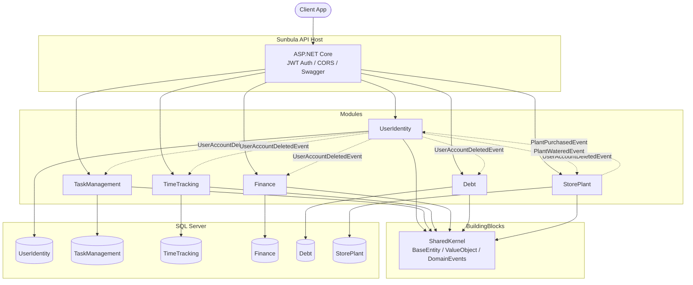

# Sunbula — Modular Monolith Backend

[](https://dotnet.microsoft.com/)
[](LICENSE)

A productivity and personal finance management platform built as a **Modular Monolith** with **.NET 10**, **Clean Architecture**, and **Domain-Driven Design**.

The system combines task management, time tracking (Pomodoro), personal finance, debt tracking, and gamified plant growing into a single deployable unit with strict module boundaries.

---

## Architecture

The backend is organized as six autonomous modules, each following Clean Architecture layers (`Domain → Application → Infrastructure → Presentation`), communicating through in-process domain events via **MediatR**.



### Event Flow

Cross-module communication uses MediatR `INotification` events defined in `SharedKernel`:

| Event | Publisher | Subscribers |
| :--- | :--- | :--- |
| `UserAccountDeletedEvent` | UserIdentity | TaskManagement, TimeTracking, Finance, Debt, StorePlant |
| `PlantPurchasedEvent` | StorePlant | UserIdentity (deducts coins) |
| `PlantWateredEvent` | StorePlant | UserIdentity (deducts coins) |

### Module Structure

Each module follows Clean Architecture with four layers:

```
Modules/{ModuleName}/
├── Domain/            # Entities, Value Objects, Domain Events, Repository Contracts
├── Application/       # Services, DTOs, Event Handlers
├── Infrastructure/    # EF Core DbContext, Migrations, Service Implementations
└── Presentation/      # API Controllers (registered as ApplicationPart)
```

Each module owns its own `DbContext`. No cross-context database joins.

---

## Modules

| Module | Description |
| :--- | :--- |
| **UserIdentity** | Registration, JWT authentication, token refresh, email confirmation, role management |
| **TaskManagement** | Task CRUD, categories, priorities, deadlines |
| **TimeTracking** | Pomodoro sessions, focus logging, coin rewards |
| **Finance** | Income/expense ledger, financial categories, transaction history |
| **Debt** | Debtor/creditor management, installment tracking, settlement |
| **StorePlant** | Gamification — spend coins to buy and grow virtual plants |

---

## Tech Stack

| Component | Technology |
| :--- | :--- |
| Runtime | .NET 10 / C# |
| Web Framework | ASP.NET Core Web API |
| ORM | Entity Framework Core 10 (Code-First) |
| Database | SQL Server |
| Messaging | MediatR |
| Mapping | AutoMapper |
| Auth | JWT Bearer + ASP.NET Core Identity |
| API Docs | Swagger (Swashbuckle) |
| Testing | xUnit + WebApplicationFactory |

---

## Getting Started

### Prerequisites

- [.NET 10 SDK](https://dotnet.microsoft.com/download/dotnet/10.0)
- [SQL Server](https://www.microsoft.com/en-us/sql-server/sql-server-downloads) (LocalDB, Express, or Developer)

### Setup

1. **Clone the repository:**

   ```bash
   git clone https://github.com/hassans22hh-ship-it/SunbulaGraduationProject.git
   cd SunbulaGraduationProject
   ```

2. **Create your local configuration:**

   ```bash
   cp Sunbula/appsettings.Example.json Sunbula/appsettings.json
   ```

3. **Edit `Sunbula/appsettings.json`** with your SQL Server connection string, JWT secret key, and email credentials:

   ```json
   {
     "ConnectionStrings": {
       "SunbulaDb": "Server=localhost;Database=Sunbula;Trusted_Connection=True;TrustServerCertificate=True;"
     },
     "Jwt": {
       "SecretKey": "your-secret-key-at-least-256-bits",
       "Issuer": "http://localhost:5142",
       "Audience": "SunbulaClient"
     },
     "EmailSettings": {
       "Email": "your-email@gmail.com",
       "Password": "your-gmail-app-password",
       "Host": "smtp.gmail.com",
       "Port": 587
     }
   }
   ```

4. **Run the application:**

   ```bash
   dotnet run --project Sunbula
   ```

   The app automatically applies all database migrations and seeds default data on startup.

5. **Explore the API:**
   - Swagger UI: `http://localhost:5142/swagger`
   - Health check: `http://localhost:5142/health`
   - Default admin: `admin@sunbula.com` / `AdminPassword123!`

### Manual Migrations (Optional)

If you prefer to run migrations manually instead of relying on auto-migration:

```bash
dotnet ef database update --context UserIdentityDbContext --project Sunbula
dotnet ef database update --context TaskManagementDbContext --project Sunbula
dotnet ef database update --context TimeTrackingDbContext --project Sunbula
dotnet ef database update --context FinanceDbContext --project Sunbula
dotnet ef database update --context DebtDbContext --project Sunbula
dotnet ef database update --context StorePlantDbContext --project Sunbula
```

---

## Testing

```bash
dotnet test
```

Integration tests are located in `Sunbula.IntegrationTests/` covering authentication, task management, finance, debt, time tracking, and store plant workflows.

---

## Frontend

The Angular frontend is in a separate repository ([SunbulaFrontEnd](https://github.com/hassans22hh-ship-it/SunbulaFrontEnd)).

Default CORS is configured for `http://localhost:4200`.

---

## Project Structure

```
SunbulaGraduationProject/
├── BuildingBlocks/
│   └── SharedKernel/              # Base abstractions and domain event contracts
├── Modules/
│   ├── UserIdentity/              # Auth & identity bounded context
│   ├── TaskManagement/            # Task management bounded context
│   ├── TimeTracking/              # Pomodoro & sessions bounded context
│   ├── Finance/                   # Personal finance bounded context
│   ├── Debt/                      # Debt tracking bounded context
│   └── StorePlant/                # Gamification bounded context
├── Sunbula/                       # API host, composition root, middleware
├── Sunbula.IntegrationTests/      # Integration test suite
└── LICENSE
```

---

## License

[MIT](LICENSE)
